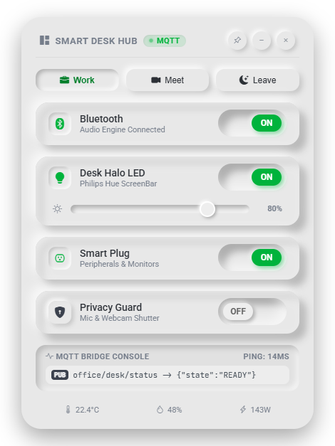

# Electron Smart Desk Widget

Neumorphic Electron.js desktop widget for controlling smart desk & office IoT devices — scenes, dimmable lights, smart plug and privacy guard with MQTT-style telemetry.

<p align="center">
  
</p>

## Features

- Frameless, transparent, draggable desktop widget
- Quick scenes: **Work**, **Meet**, **Leave**
- Toggles for Bluetooth audio, desk LED (with brightness dimmer), smart plug and privacy guard
- Live MQTT bridge console and estimated power draw
- Pin on top, minimize, and hide to system tray (quit from the tray menu)

> Device control and MQTT messages are currently simulated in the UI.

## Getting Started

```bash
npm install
npm start
```

If Electron fails to start with a missing binary error (npm 11 may block install scripts), run:

```bash
node node_modules/electron/install.js
```

## Build (Windows installer)

```bash
npm run dist
```

## Project Structure

```
main.js        Main process: window, tray, IPC handlers
preload.js     Safe bridge exposed to the page as window.desk
src/index.html Widget UI (HTML, CSS, JS)
docs/          Screenshots
```

## License

MIT
